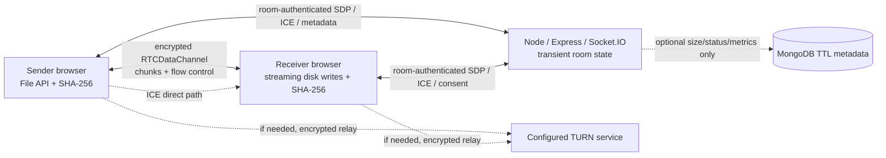

# NexusDrop

**Your files. Your devices. No distance.**

NexusDrop is a browser-based peer-to-peer file-transfer application. The signaling service coordinates an authenticated one-sender/one-receiver room; file bytes travel over an encrypted WebRTC data channel and are not uploaded to the application server. A configured TURN relay may temporarily forward the encrypted traffic when direct connectivity is unavailable.

> This repository is a functional first release, not a guarantee that all networks, browsers, file sizes, or hosting plans will work. Configure production HTTPS, TURN and persistent WebSocket hosting before exposing it to users.

## Features

- React + Vite responsive UI for sending, receiving, file consent, progress and status.
- Express + Socket.IO in-memory rooms, random room IDs, 256-bit sender/invite bearer tokens, one sender and one receiver, room expiry, payload limits and basic per-socket rate limiting.
- Native WebRTC peer connection, trickle ICE and ordered data channel.
- 60 KiB binary chunks, sequence/offset validation, `bufferedAmount` backpressure, bounded in-flight channel buffering, pause/cancel and incremental SHA-256 integrity verification.
- Chromium File System Access API save destination selected during receiver consent; browser-memory fallback where streaming writes are unavailable.
- Optional MongoDB TTL metadata collection for transfer size/status/timing only; room credentials and file contents are never persisted.

## Architecture



The signaling server is required to rendezvous peers, but it does not store file bytes. WebRTC connectivity may be direct or relayed. STUN alone does not solve all NAT/firewall configurations.

## Requirements and installation

- Node.js 22.12+ and npm (Vite 8 frontend toolchain; backend itself supports Node.js 20.19+).
- A modern WebRTC browser. Production use requires HTTPS.

```bash
cp backend/.env.example backend/.env
cp frontend/.env.example frontend/.env
npm install
npm --prefix backend install
npm --prefix frontend install
npm run dev
```

Open `http://localhost:5173`. In local development the API defaults to `http://localhost:3001`. For two-device testing, both browsers must reach the same signaling URL, and ICE configuration must permit connectivity between their networks. Vite's local URL is not itself a public deployment.

### Environment variables

`backend/.env.example`:

- `PORT`: Node listener port (default 3001).
- `ALLOWED_ORIGINS`: comma-separated exact frontend origins; set the deployed HTTPS origin(s), not `*`.
- `ROOM_TTL_MS`: room lifetime (default one hour).
- `MAX_ROOMS`: maximum simultaneous rooms (default 1,000).
- `MONGODB_URI`: optional backend-only connection string; unset disables MongoDB.
- `MONGODB_DB_NAME`: database name (default `nexusdrop`).
- `METADATA_RETENTION_DAYS`: TTL retention for aggregate records (default 30 days).

`frontend/.env.example` (values are public browser configuration):

- `VITE_SIGNALING_URL`: public HTTPS/WSS signaling origin.
- `VITE_ICE_SERVERS_JSON`: valid JSON array of ICE server objects. A public STUN server is included in the app fallback. Configure a TURN provider for production connectivity. Never embed a long-lived TURN secret in `VITE_*`; use provider-issued time-limited credentials delivered by a protected endpoint or deployment integration.

## Testing

```bash
npm test
npm run build
```

Backend tests exercise health/status, room creation, bad invite rejection, single-receiver behavior, authenticated metadata/signaling forwarding, oversized payload rejection, and the optional MongoDB adapter's disabled mode/input validation. Frontend unit tests cover chunk framing and malformed-frame bounds.

**Actually run in this build:** backend tests: 5 passed; frontend tests: 3 passed; Vite production build: passed. These tests do not use two real browser peers and do not constitute a cross-network/TURN or large-file benchmark. A 1 GB / 5 GB transfer, browser memory profile, direct-vs-relayed route, Playwright responsive suite, live MongoDB connection, and TURN credential round trip have not been measured in this environment.

For a manual 1 GB / 5 GB verification: deploy over HTTPS; use two separate devices and networks; configure a working TURN service; send a test file with a known SHA-256; choose a disk destination on a Chromium receiver; keep both tabs foreground/open; compare displayed integrity outcome and externally calculated hashes; record elapsed time, average throughput, browser versions, memory, ICE candidate type, and whether a relay was selected. Do not use a memory-fallback browser for multi-gigabyte tests.

## Large-file transfer and limits

The sender reads `File.slice()` sequentially into at most one 60 KiB chunk per send iteration. DataChannel buffering is held under a 1 MiB threshold using `bufferedAmountLowThreshold`. The receiver validates transfer ID, ordered sequence, offset, and byte length, then updates SHA-256 incrementally. It uses `showSaveFilePicker()` where supported and opened by a user gesture, then writes received chunks incrementally. The final size and SHA-256 must match before success is reported.

Browsers without a usable incremental-write API use a Blob download fallback that retains file chunks in browser memory. That is **not** suitable for reliably receiving multi-gigabyte files. The UI's 50 GB maximum is only a protocol/product guardrail, not an assertion that a particular device can transfer that amount. Available disk, browser limitations, network stability, TURN bandwidth/cost, firewall policies and power/sleep behavior matter.

Pause prevents new chunks but bytes already buffered may arrive. Resume is possible only while the same data channel stays open; a lost connection, tab refresh, browser close, or device shutdown requires a new transfer. There is no persistent resumable transfer state. The receiver-selected path is controlled by the browser.

## STUN and TURN

Use a STUN service to discover candidate network addresses. For production reliability, operate or contract a TURN service (for example, coturn) with TLS/TCP and UDP relay options, valid certificates, appropriate firewall ports, rate/bandwidth controls, and short-lived authenticated credentials. Set `VITE_ICE_SERVERS_JSON` to the authorized server URLs and current credential object. This frontend expects the credentials at build time; do not build with static private TURN credentials. For real deployments, implement an authenticated ephemeral ICE-credential endpoint and fetch the credentials at room setup. No TURN server or credentials are bundled here.

When ICE uses a relay, traffic passes through TURN temporarily. DTLS protects WebRTC transport in transit. This is not a promise of privacy against a compromised device, malicious page/application code, or the receiving participant.

## Production deployment strategy

1. Build `frontend/` and deploy `frontend/dist/` to a static host with HTTPS (for example, an object-store/CDN static site). Configure the SPA fallback to `index.html`.
2. Deploy `backend/` as a persistent Node.js service/container on a platform that supports stable WebSockets, sticky routing or a single instance, and graceful shutdown. A multi-instance deployment needs a shared Socket.IO adapter and distributed room/auth state; current rooms are process-local.
3. Configure exact `ALLOWED_ORIGINS`, set `VITE_SIGNALING_URL` to the public HTTPS origin, and provide a separately administered STUN/TURN service. HTTPS frontend and WSS backend are required outside local development.
4. Verify hosting limits, idle timeouts, WebSocket proxying, resource quotas, bandwidth charges and TURN egress. Do not assume free plans provide reliable long-running sockets or unlimited transfer capacity.
5. Monitor only non-sensitive operational metrics. Current `/health` and `/api/status` do not disclose tokens or file contents.

Backend start: `npm --prefix backend start`. Frontend build: `npm --prefix frontend run build`. `docker-compose.yml` is provided for local orchestration only; it is not a production TURN deployment.

## API and signaling contract

- `GET /health`: `{ ok: true }`.
- `GET /api/status`: in-memory room count, configured room cap, `fileStorage: false`, and whether metadata MongoDB is enabled; no secret values.
- Socket events and transfer message details: [docs/SIGNALING_PROTOCOL.md](docs/SIGNALING_PROTOCOL.md) and [docs/TRANSFER_PROTOCOL.md](docs/TRANSFER_PROTOCOL.md).

## Security and privacy notes

Invitation URLs are bearer credentials: share them only with the intended recipient. Sender and receiver tokens are cryptographically random and room-scoped; room codes alone do not authorize access. HTTPS protects signaling in production. No file contents are intentionally sent to the signaling service or logged. Rooms and credentials are volatile and expire. If enabled, MongoDB persists only transfer size/status/timing for a limited retention period; filenames, tokens, room IDs, and contents are excluded. This initial service has per-socket in-memory rate limits and no distributed room persistence; add a trusted reverse proxy, IP-level rate limiting, abuse monitoring, a credential service for ephemeral TURN credentials, and a shared Socket.IO adapter before scaling. Do not put secrets in frontend environment variables.

See [docs/SECURITY.md](docs/SECURITY.md), [docs/DEPLOYMENT.md](docs/DEPLOYMENT.md) and [docs/TROUBLESHOOTING.md](docs/TROUBLESHOOTING.md).

For coturn topology, secure listener guidance and the missing short-lived credential service step, see [docs/COTURN.md](docs/COTURN.md).

For database setup and the exact metadata schema, see [docs/DATABASE.md](docs/DATABASE.md).

## Known limitations and future work

- No measured real-browser-to-real-browser transfer or 1 GB/5 GB benchmark is included.
- No TURN instance/credentials, public deployment, HTTPS certificate, or real cross-network relay has been configured.
- Memory fallback can exhaust memory on large files.
- No robust reconnection or cross-refresh resume; pause only works on the existing open channel.
- No automated Playwright browser suite, persistent metrics, distributed room store, or production IP-based throttling.
- Improve signed/ephemeral TURN credential issuance, transfer ACK-based recovery, adaptive chunk sizing, broader browser compatibility, and load/security testing before production use.
